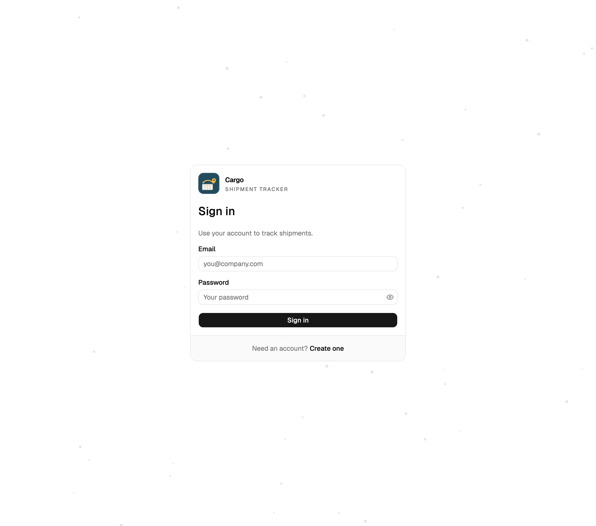
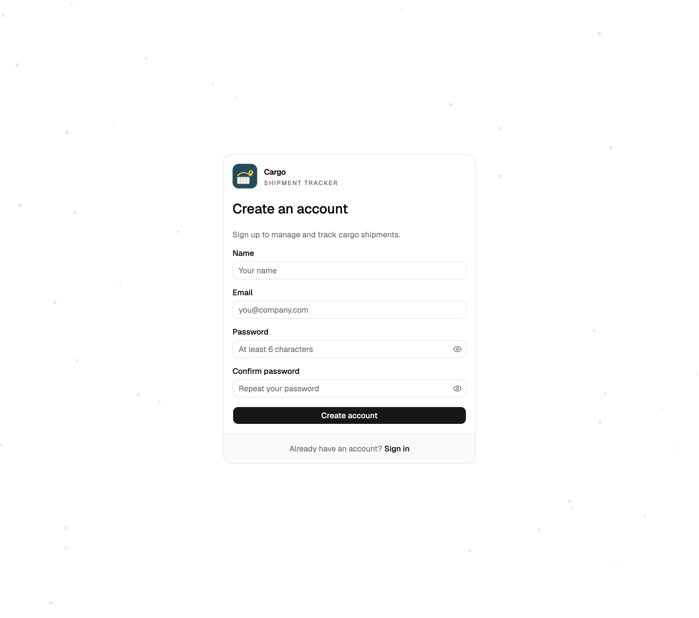
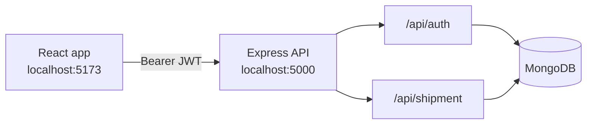

<center>
  <p align="center" style="text-align: center">
    
  </p>
  <h1 align="center" style="text-align: center">Waypoint Shipment Tracker</h1>
  <p align="center" style="text-align: center">
    A full-stack shipment tracker built with React, Vite, and Express — sign in, log a container route, update its location, and open the trip on a map.
  </p>
  <p align="center" style="display: flex; align-items: center; justify-content: center; gap:10px;">
    
    
    
    
    
  </p>

  <h4 align="center" style="text-align: center">
    <a href="https://waypoint-shipment-tracker.vercel.app/" target="_blank" rel="noopener noreferrer">🚀 Live Demo</a>
    <span> · </span>
    <a href="https://github.com/itskaushikverma/Waypoint-Shipment-Tracker" target="_blank" rel="noopener noreferrer">📁 Repository</a>
  </h4>
</center>

## 📚 Table of Contents

- [About the Project](#about-the-project)
- [Screenshots](#screenshots)
- [Tech Stack](#tech-stack)
- [Features](#features)
- [Architecture](#architecture)
- [Getting Started](#getting-started)
- [Available Scripts](#available-scripts)
- [API](#api)
- [Project Structure](#project-structure)
- [Deployment](#deployment)
- [Contributing](#contributing)
- [Contact](#contact)

<a id="about-the-project"></a>

## ✨ About the Project

Waypoint is a small shipment tracker with a React client and an Express API. After sign-in, the dashboard lists your shipments, lets you add a numeric container with a start and end point, and opens any trip on an OpenStreetMap view.

Each JSON response uses the same envelope:

```json
{ "success": true, "data": {}, "message": "Logged in successfully." }
```

Failed requests use `"success": false` and `"data": null`.

<a id="screenshots"></a>

## 📸 Screenshots

<table>
  <tr>
    <td width="50%" align="center"></td>
    <td width="50%" align="center"></td>
  </tr>
</table>

<a id="tech-stack"></a>

## 🛠️ Tech Stack

- ⚛️ React 19
- ⚡ Vite 8
- 🎨 Tailwind CSS 4
- 🧩 shadcn/ui
- 🗺️ Leaflet
- 🔄 Redux Toolkit Query
- 🧾 React Hook Form
- ✅ Zod
- 🚂 Express 5
- 🍃 MongoDB + Mongoose
- 🔐 JWT + bcrypt
- 🧹 ESLint + Prettier

<a id="features"></a>

## 🌟 Features

- Sign up, sign in, stay signed in with a JWT, and log out
- Sort the shipment list by container ID, location, ETA, or status
- Add a numeric container ID, coordinates, and a status (`Pending` or `In Transit`)
- Update the current point and recalculate ETA toward the destination
- Show the start, current position, destination, and remaining path on a map
- Keep each account limited to its own shipments

<a id="architecture"></a>

## 🏗️ Architecture

The React app sends a Bearer JWT to the Express API. Auth and shipment routes both read and write MongoDB.



<a id="getting-started"></a>

## 🚀 Getting Started

### 📋 Prerequisites

- Node.js 20 or newer
- npm
- MongoDB

### 💻 Run Locally

Clone the project:

```bash
git clone https://github.com/itskaushikverma/Waypoint-Shipment-Tracker.git
```

Move into the project folder:

```bash
cd Waypoint-Shipment-Tracker
```

Start the API:

```bash
cd Backend
cp .env.example .env
npm install
npm start
```

The API listens on [http://localhost:5000](http://localhost:5000).

In a second terminal, start the web app:

```bash
cd Frontend
cp .env.example .env
npm install
npm run dev
```

Open [http://localhost:5173](http://localhost:5173).

### 🔐 Environment

`Backend/.env`

| Variable                     | Purpose                                                               |
| ---------------------------- | --------------------------------------------------------------------- |
| `PORT`                       | API port. Local default is `5000`.                                    |
| `MONGO_URI`                  | MongoDB connection string.                                            |
| `JWT_SECRET`                 | Signing secret. Use at least 32 characters.                           |
| `FRONTEND_URL`               | Allowed browser origin, for example `http://localhost:5173`.          |
| `CHECK_DISPOSABLE_EMAIL_URL` | Optional disposable-email check. Signup still works if this is unset. |

`Frontend/.env`

| Variable       | Purpose                         |
| -------------- | ------------------------------- |
| `VITE_API_URL` | API base URL, including `/api`. |

<a id="available-scripts"></a>

## 📜 Available Scripts

From the repository root:

- `npm run lint` — lint the web app and the API
- `npm run format` — format the repo with Prettier
- `npm run check` — run lint, then format

From `Frontend/`:

- `npm run dev` — start the local development server
- `npm run build` — build the app for production
- `npm run preview` — preview the production build locally
- `npm run lint` — run ESLint checks

From `Backend/`:

- `npm start` — start the API
- `npm run lint` — run ESLint checks
- `npm test` — run the Node test runner

<a id="api"></a>

## 🔌 API

Send the access token as `Authorization: Bearer <token>`.

| Method | Path                               | Auth |
| ------ | ---------------------------------- | ---- |
| `POST` | `/api/auth/signup`                 | No   |
| `POST` | `/api/auth/login`                  | No   |
| `POST` | `/api/auth/logout`                 | Yes  |
| `GET`  | `/api/auth/me`                     | Yes  |
| `GET`  | `/api/shipment`                    | Yes  |
| `POST` | `/api/shipment`                    | Yes  |
| `GET`  | `/api/shipment/:id`                | Yes  |
| `POST` | `/api/shipment/:id/updatelocation` | Yes  |
| `GET`  | `/api/shipment/:id/eta`            | Yes  |
| `GET`  | `/api/health`                      | No   |

<a id="project-structure"></a>

## 🧩 Project Structure

```text
.
├── Backend/
│   ├── config/
│   ├── controllers/
│   ├── models/
│   ├── routes/
│   ├── utils/
│   └── index.js
├── Frontend/
│   └── src/
│       ├── components/
│       ├── pages/
│       ├── redux/
│       ├── App.jsx
│       └── main.jsx
└── docs/
    ├── logo.png
    └── screenshots/
```

<a id="deployment"></a>

## 🌐 Deployment

Build the web app:

```bash
cd Frontend
npm run build
npm run preview
```

Run the API with the production environment variables set in `Backend/.env`:

```bash
cd Backend
npm start
```

<a id="contributing"></a>

## 🤝 Contributing

Contributions, issues, and feature suggestions are welcome.

If you would like to contribute:

- fork the repository
- create a feature branch
- commit your changes
- open a pull request

<!-- AUTHOR:START -->
<h2 id="contact" style="margin: 12px 0 8px">👤 Author</h2>
<div align="center" style="margin: 0">
  
  <h3 style="margin: 8px 0 4px">Kaushik Verma</h3>
  <p style="margin: 0 0 8px"><em>Building AI tools that turn long documents into clear decisions.</em></p>
  <p style="margin: 0 0 8px">
    <a href="mailto:kaushikverma321@gmail.com"></a>
    <a href="https://www.kaushikverma.com"></a>
    <a href="https://github.com/itskaushikverma"></a>
    <a href="https://www.linkedin.com/in/itskaushikverma"></a>
    <a href="https://x.com/SilentK68296830"></a>
  </p>
  <p style="margin: 0">Open to product feedback, collaboration, and thoughtful conversation.</p>
</div>
<div align="center" style="margin: 8px 0 0">
  <p style="margin: 0 0 4px">If you found this project helpful, please consider giving it a ⭐️</p>
  <a href="https://github.com/itskaushikverma/Waypoint-Shipment-Tracker"></a>
</div>
<!-- AUTHOR:END -->
