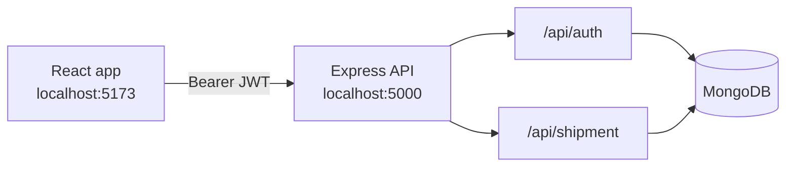

<p align="center">
  
</p>

<h1 align="center">Waypoint Shipment Tracker</h1>

<p align="center">
  Sign in, log a container route, update its location, and open the trip on a map.
</p>

<p align="center">
  &nbsp;&nbsp;&nbsp;&nbsp;
  &nbsp;&nbsp;&nbsp;&nbsp;
  &nbsp;&nbsp;&nbsp;&nbsp;
  &nbsp;&nbsp;&nbsp;&nbsp;
  
</p>

---

## Preview

| Sign in                                                                | Create an account                                                              |
| ---------------------------------------------------------------------- | ------------------------------------------------------------------------------ |
|  |  |

After sign-in, the dashboard lists your shipments, lets you add a numeric container with a start and end point, and opens any trip on an OpenStreetMap view.

## Features

- **Accounts** — Sign up, sign in, stay signed in with a JWT, and log out.
- **Shipment list** — Sort by container ID, location, ETA, or status.
- **Add shipment** — Enter a numeric container ID, coordinates, and status (`Pending` or `In Transit`).
- **Live location** — Update the current point; ETA is recalculated toward the destination.
- **Map** — Start, current position, destination, and remaining path on a map.
- **Owned data** — Each user only sees and edits their own shipments.

## Tech stack

| Layer   | Tools                                                                               |
| ------- | ----------------------------------------------------------------------------------- |
| Web app | React 19, Vite, Redux Toolkit Query, React Router, Tailwind CSS, shadcn/ui, Leaflet |
| API     | Node.js, Express 5, Mongoose, JWT, bcrypt                                           |
| Data    | MongoDB                                                                             |

## Architecture



Every JSON response uses the same envelope:

```json
{ "success": true, "data": {}, "message": "Logged in successfully." }
```

Failed requests use `"success": false` and `"data": null`.

## Getting started

Use **Node.js 20+** and a MongoDB database.

### 1. Clone

```bash
git clone https://github.com/itskaushikverma/waypoint.git
cd waypoint
```

### 2. API

```bash
cd backend
cp .env.example .env
npm install
npm start
```

The API listens on [http://localhost:5000](http://localhost:5000).

### 3. Web app

In a second terminal:

```bash
cd frontend
cp .env.example .env
npm install
npm run dev
```

Open [http://localhost:5173](http://localhost:5173).

## Environment

### `backend/.env`

| Variable                     | Purpose                                                               |
| ---------------------------- | --------------------------------------------------------------------- |
| `PORT`                       | API port. Local default is `5000`.                                    |
| `MONGO_URI`                  | MongoDB connection string.                                            |
| `JWT_SECRET`                 | Signing secret. Use at least 32 characters.                           |
| `FRONTEND_URL`               | Allowed browser origin, for example `http://localhost:5173`.          |
| `CHECK_DISPOSABLE_EMAIL_URL` | Optional disposable-email check. Signup still works if this is unset. |

### `frontend/.env`

| Variable       | Purpose                         |
| -------------- | ------------------------------- |
| `VITE_API_URL` | API base URL, including `/api`. |

## API

Send the access token as `Authorization: Bearer <token>`.

| Method | Path                               | Auth |
| ------ | ---------------------------------- | ---- |
| `POST` | `/api/auth/signup`                 | No   |
| `POST` | `/api/auth/login`                  | No   |
| `POST` | `/api/auth/logout`                 | Yes  |
| `GET`  | `/api/auth/me`                     | Yes  |
| `GET`  | `/api/shipment`                    | Yes  |
| `POST` | `/api/shipment`                    | Yes  |
| `GET`  | `/api/shipment/:id`                | Yes  |
| `POST` | `/api/shipment/:id/updatelocation` | Yes  |
| `GET`  | `/api/shipment/:id/eta`            | Yes  |
| `GET`  | `/health`                          | No   |

## Project structure

```text
.
├── backend/          Express API
│   ├── controllers/
│   ├── models/
│   ├── routes/
│   └── utils/
├── frontend/         React app
│   └── src/
│       ├── components/
│       ├── pages/
│       └── redux/
└── docs/screenshots/
```

---

<!-- AUTHOR:START -->

## 👨‍💻 Author

**Kaushik Verma**

<p align="center">
  <a href="https://www.kaushikverma.com"></a>&nbsp;&nbsp;
  <a href="https://github.com/itskaushikverma"></a>&nbsp;&nbsp;
  <a href="https://www.linkedin.com/in/itskaushikverma"></a>&nbsp;&nbsp;
  <a href="https://x.com/SilentK68296830"></a>&nbsp;&nbsp;
  <a href="https://www.instagram.com/itskaushikverma"></a>&nbsp;&nbsp;
  <a href="mailto:kaushikverma321@gmail.com"></a>
</p>
<!-- AUTHOR:END -->
